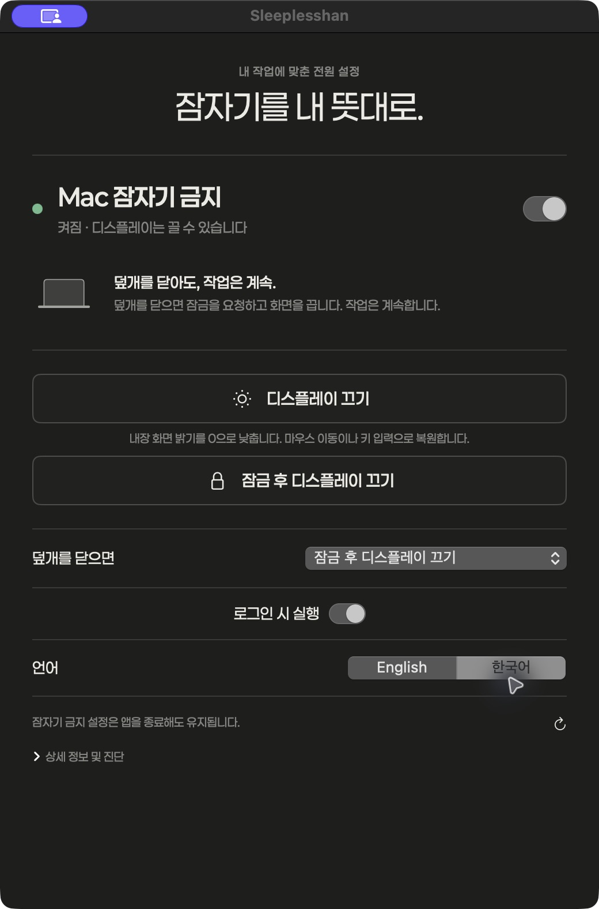

# Sleeplesshan

Mac의 잠자기 금지, 화면 끄기, 덮개를 닫을 때의 동작을 한 곳에서 제어하는 작은 macOS 앱입니다.

[English](README.md) · [검증 및 복구 안내](docs/verification.md)




## 주요 기능

- 시스템의 실제 잠자기 금지 상태를 읽어 표시합니다. 다른 도구에서 변경한 설정도 자동으로 반영됩니다.
- **디스플레이 끄기**와 **잠금 후 디스플레이 끄기**를 별도 버튼으로 제공합니다.
- 잠자기 금지가 켜진 상태에서 덮개를 닫으면 선택한 화면 동작을 실행합니다.
- Dock과 메뉴 막대에서 열 수 있습니다. 창을 닫아도 실행되며 앱을 종료해도 전역 잠자기 금지 설정은 유지됩니다.
- 한국어·영어를 즉시 전환하고 시스템의 밝은·어두운 모드를 따릅니다.
- 계정, 분석 도구, 네트워크 연결, 외부 런타임 없이 로컬에서 실행됩니다.

## 다운로드

**[Apple Silicon용 Sleeplesshan 다운로드](https://github.com/sleeplesshan/nosleep/releases/latest/download/Sleeplesshan-0.1.0-macOS-arm64.zip)** · [전체 릴리스](https://github.com/sleeplesshan/nosleep/releases)

macOS 14 이상, M 시리즈 Mac용입니다. ZIP 압축을 풀고 `Sleeplesshan.app`을 응용 프로그램 폴더로 옮기면 됩니다. **Xcode 설치나 소스 빌드는 필요하지 않습니다.** 이번 릴리스에는 Intel용 바이너리가 포함되지 않습니다.

이번 파일은 ad-hoc 서명이며 **Apple Developer ID 서명·공증은 없습니다.** 첫 실행 시 macOS가 차단할 수 있습니다. 배포본을 신뢰하여 실행하기로 선택한 경우 [Apple의 앱 실행 안내](https://support.apple.com/ko-kr/102445)를 따르세요. 릴리스에 설치 안내와 SHA-256 체크섬을 제공합니다.

잠금 기능에는 손쉬운 사용 권한, 잠자기 금지 변경에는 관리자 인증이 필요할 수 있습니다. 업데이트할 때는 기존 앱을 종료하고 같은 위치에 교체하세요. ad-hoc 빌드가 변경되면 손쉬운 사용 권한에 앱을 다시 추가해야 할 수 있습니다.

## 소스에서 빌드 및 실행

macOS 14 이상, Swift 6 도구 체인을 포함한 Xcode가 필요합니다. 첫 버전의 실제 실행 검증 대상은 Apple Silicon Mac입니다.

```bash
git clone https://github.com/sleeplesshan/nosleep.git
cd nosleep
swift test
bash scripts/build.sh
bash scripts/install.sh
open ~/Applications/Sleeplesshan.app
```

`outputs/Sleeplesshan.app`은 로컬 ad-hoc 서명 앱이며 Apple의 Developer ID 서명·공증 배포본이 아닙니다. 서명 인증서가 있으면 `NOSLEEP_SIGNING_IDENTITY` 환경 변수로 지정할 수 있습니다. 권한을 부여한 뒤에는 설치 경로를 유지하세요. ad-hoc 앱을 다시 빌드하면 손쉬운 사용 권한을 다시 부여해야 할 수 있습니다.

## 알아둘 동작

**잠자기 금지:** 일시적인 `caffeinate`가 아닌 전역 `pmset -a disablesleep 1/0`을 제어합니다. 관리자 인증이 필요하며 기존에 해당 명령만 허용한 권한 설정이 있으면 사용합니다. 비밀번호를 저장하거나 sudoers를 수정하지 않습니다. 해제해도 다른 앱의 잠자기 방지와 기존 자동 잠자기 시간은 유지됩니다.

**디스플레이 끄기:** 내장 디스플레이의 실제 밝기를 저장하고 0으로 낮춥니다. 디스플레이 잠자기나 검은 창 덮기, 감마 조정이 아닙니다. 마우스를 움직이면 이전 밝기로 복원되고, 손쉬운 사용 권한이 있으면 키 입력으로도 복원합니다. 밝기 증가 키도 사용할 수 있습니다. 밝기 0 상태에서는 앱이 자동 디스플레이 잠자기를 방지하며, 정상 종료 때 복원하고 재실행 시 남은 복구 기록을 처리합니다. 사용자가 직접 변경한 밝기는 덮어쓰지 않습니다. 첫 버전은 내장 화면을 지원하며 미지원 외부 모니터를 검은 화면으로 흉내 내지 않습니다.

Apple Silicon의 밝기 조절에는 동적으로 읽는 `DisplayServices` 비공개 함수를 사용합니다. macOS 업데이트로 변경될 수 있어 함수 존재·지원 여부·실제 적용 값을 검사합니다. 잠금에는 비공개 API를 사용하지 않습니다.

**잠금 후 디스플레이 끄기:** 손쉬운 사용 권한으로 기본 잠금 단축키 `⌃⌘Q`를 보낸 뒤 1.5초 후 화면 끄기를 요청합니다. 단축키 전송만으로 잠금 완료를 확인할 수는 없습니다. 단축키를 바꾼 경우 실제 인증 요구를 확인한 후 사용하세요. 비공개 잠금 API나 암호 요구 설정 변경은 사용하지 않습니다.

**덮개 자동화:** 새 설치에서는 기본적으로 꺼져 있습니다. 원하는 덮개 동작을 선택하고 필요하면 로그인 시 실행을 켜세요. 앱이 실행 중이고 잠자기 금지가 켜져 있을 때 동작합니다. 이미 덮개가 닫힌 상태에서 실행했다고 갑자기 잠금하지 않습니다. 배터리 소진이나 하드웨어 보호 동작까지 막지는 않습니다.

## 개발과 검증

SwiftUI/AppKit 인터페이스, IORegistry 덮개 관찰, ServiceManagement 로그인 등록을 사용합니다. `NoSleepCore`는 시스템 상태 파싱과 변경 검증, 덮개 전환을 담당하며 실제 전원 설정을 건드리지 않는 테스트로 검증합니다.

UI가 보일 때 1초, 백그라운드에서 3초 간격으로 상태를 읽고 앱 활성화와 덮개 전환 시 즉시 갱신합니다. 오류나 인증 취소를 성공으로 표시하지 않습니다.

이전 덮개 감시기를 사용하는 Mac에는 백업·이전 기능이 표시됩니다. 다른 잠자기 방지 프로세스는 중지하지 않습니다. [검증 결과와 복구 방법](docs/verification.md)을 참고하세요.

[디자인 참고 이미지](docs/images/design-reference.png)는 AI로 만든 목업이며 실제 앱 스크린샷과 구분합니다. 실제 컨트롤·텍스트·아이콘은 네이티브로 구현했습니다.

## 라이선스

코드는 [MIT](LICENSE), 포함된 Paperlogy 폰트는 `Resources/Fonts`의 SIL Open Font License를 따릅니다. Apple 및 다른 동명의 유틸리티와 관계없는 독립 프로젝트입니다.
