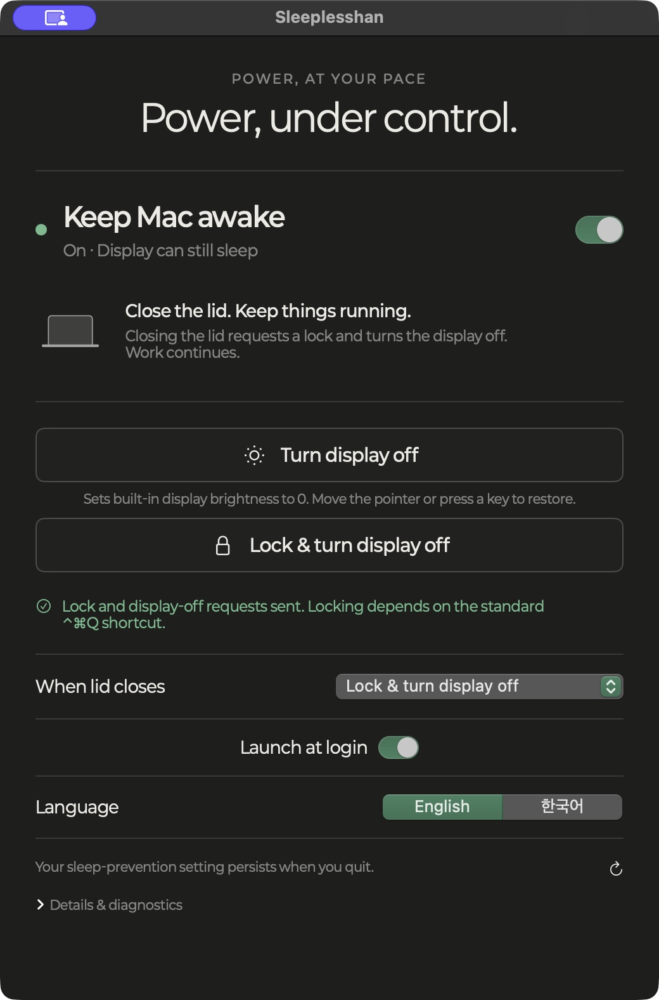

# Sleeplesshan

A small macOS control panel for keeping your Mac awake, turning displays off, and choosing what happens when you close the lid.

[한국어](README.ko.md) · [Build and test](#build) · [Behavior and verification](docs/verification.md)



## What it does

- Controls the global `pmset disablesleep` setting and reads the real value back. Changes from other tools appear automatically.
- Offers **Turn display off** (built-in hardware brightness to zero) and **Lock & turn display off** (session lock request, then display sleep).
- Watches for an open-to-closed lid transition while sleep prevention is on, with an optional display-off or lock-and-display-off action.
- Lives in the Dock and menu bar. Closing the window keeps the app running; quitting leaves the global power setting unchanged.
- Switches every user-facing control between English and Korean immediately. Follows system light/dark appearance.
- Runs locally, without accounts, analytics, network access, or third-party runtime dependencies.

## Build

Requires macOS 14 or later and Xcode with a Swift 6 toolchain. The first version is tested on Apple Silicon; other hardware and OS versions require verification.

```bash
git clone https://github.com/sleeplesshan/nosleep.git
cd nosleep
swift test
bash scripts/build.sh
bash scripts/install.sh
open ~/Applications/Sleeplesshan.app
```

The build script produces a locally ad-hoc-signed `.app`, not a Developer ID signed or notarized release. To sign with your own identity, set `NOSLEEP_SIGNING_IDENTITY` before building. Keep the installed app at a stable location when granting Accessibility and login-item permissions. Rebuilt ad-hoc binaries may need permission to be granted again.

Read-only diagnosis:

```bash
~/Applications/Sleeplesshan.app/Contents/MacOS/Sleeplesshan --diagnose
```

## Permissions and exact behavior

**Sleep prevention.** This is the persistent, system-wide `pmset -a disablesleep 1/0` setting, not a temporary idle-sleep assertion. Administrator authorization is needed to change it. An existing narrowly scoped passwordless rule is used if available; otherwise macOS shows an administrator authentication dialog. Sleeplesshan neither stores passwords nor edits sudoers. Turning the switch off does not remove other apps' sleep assertions or change your idle-sleep timers.

**Turn display off.** Saves the built-in display’s actual brightness and sets it to zero. It does not put the display to sleep, change gamma, or draw a black window. Move the pointer to restore; keyboard restoration also works with Accessibility permission. The hardware brightness-up key remains a fallback. An app-owned display-idle assertion prevents automatic display sleep during this dimmed session. The prior brightness is restored on normal exit and recovered on relaunch if still at zero. A manual brightness change is respected. This first version supports the built-in panel only; unsupported external monitors are not simulated.

On Apple Silicon, brightness uses optional, dynamically loaded `DisplayServices` functions, similar to the [brightness utility](https://github.com/nriley/brightness). These are undocumented Apple interfaces and may change with macOS updates. Missing functions, unsupported displays, failed writes, and readback mismatches are reported. The lock action still uses public APIs only.

**Lock and display off.** Requires Accessibility permission and sends the standard `Control–Command–Q` shortcut, followed by a display-off request after 1.5 seconds. A sent shortcut is not confirmation that the session locked. If you remapped the shortcut, verify the behavior before relying on it. Sleeplesshan does not call private lock APIs or change password settings. The app describes requests rather than falsely claiming a verified lock.

**Lid actions.** Start disabled for new installations. Choose a lid action in the app and enable launch at login if desired. Automatic actions require the app to remain running and sleep prevention to be on. Initial observation of an already-closed lid does not trigger an action. The app does not promise to override battery exhaustion or hardware protection.

## Architecture

- `NoSleepCore`: strict power-state parsing, serialized and verified power operations, and a deterministic lid state machine.
- `NoSleep`: SwiftUI interface, AppKit lifecycle/menu bar, fixed-argument process execution, IORegistry lid observation, and ServiceManagement login registration.
- `Tests`: deterministic tests with a fake backend; tests do not change system power settings or lock the screen.

State is refreshed every second while the window is visible and every three seconds in the background, and immediately on activation or lid transitions. The system value is the source of truth; preferences only store presentation and automation choices.

An optional, narrowly targeted migration supports the original standalone lid watcher. It validates the old configuration, saves a backup, verifies its service has stopped, and only then lets Sleeplesshan own lid automation. See [migration and recovery](docs/verification.md#migration-and-recovery). Other power agents are left alone.

## Design

The UI uses native text, SF Symbols, and controls, guided by an AI-generated [design reference](docs/images/design-reference.png). The reference is not a screenshot of the running app. [Design notes and generation prompt](docs/design.md) document the process. The application icon is generated deterministically by the included AppKit drawing script.

## License

[MIT](LICENSE) for code; bundled Paperlogy fonts retain their SIL Open Font License in `Resources/Fonts`. This project is independent of Apple and other similarly named utilities.
